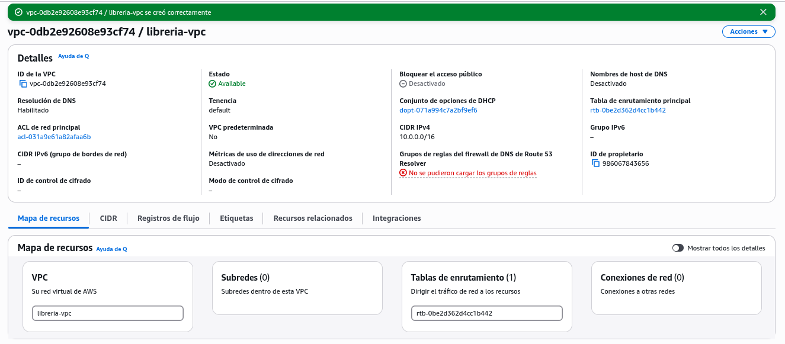
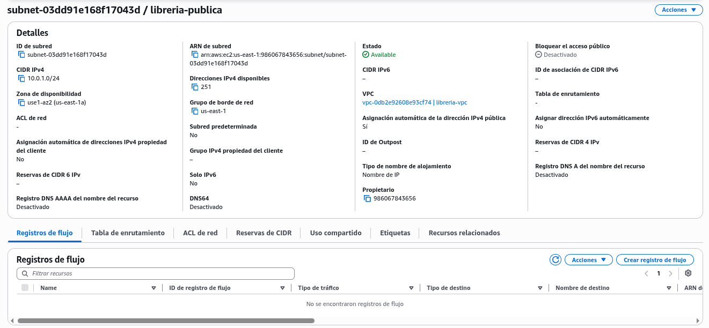
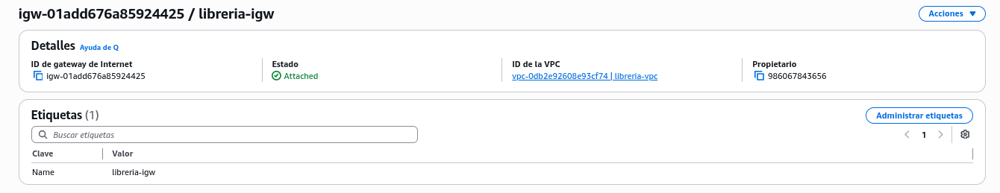

# Proyecto 1 - Mi web en AWS

## Introducción a la Nube Pública
### Primera Evaluación

**Proyecto:** Despliegue de Librería Tinta en AWS.

## B1. Infraestructura de red

### Creación de la VPC

Se ha creado una VPC en la región AWS us-east-1 (Norte de Virginia), utilizando la consola de administración de AWS.

| Parámetro | Valor |
|---|---|
| Nombre | libreria-vpc |
| ID | vpc-0db2e92608e93cf74 |
| CIDR IPv4 | 10.0.0.0/16 |
| IPv6 | Desactivado |
| Resolución DNS | Habilitada |
| Estado | Available |

La VPC proporciona una red virtual aislada donde se desplegarán los recursos del proyecto.

**Evidencia de creación:**

### Creación de la subred pública

Se ha creado una subred pública dentro de la VPC `libreria-vpc`, en la región `us-east-1`.

| Parámetro | Valor |
|---|---|
| Nombre | libreria-publica |
| ID | subnet-03dd91e168f17043d |
| VPC | libreria-vpc |
| CIDR IPv4 | 10.0.1.0/24 |
| Zona de disponibilidad | us-east-1a |
| Asignación automática de IPv4 pública | Habilitada |
| Estado | Available |

La subred dispone de 251 direcciones IPv4 utilizables por los recursos de AWS.

Se ha habilitado la asignación automática de direcciones IPv4 públicas para las instancias EC2 que se desplieguen en ella.

**Nota:** Para disponer de conectividad con Internet será necesario configurar posteriormente una puerta de enlace de Internet y la tabla de enrutamiento.

**Evidencia:**

### Creación de la puerta de enlace de Internet

Se ha creado una puerta de enlace de Internet (Internet Gateway) y se ha asociado a la VPC `libreria-vpc` desde la consola de AWS.

| Parámetro | Valor |
|---|---|
| Nombre | libreria-igw |
| ID | igw-01add676a85924425 |
| VPC asociada | libreria-vpc |
| Región | us-east-1 |
| Estado | Attached |

La puerta de enlace permite conectar la VPC con Internet. Para que las instancias EC2 de la subred pública puedan utilizarla, será necesario configurar una ruta hacia esta puerta de enlace en la tabla de enrutamiento.

**Evidencia:**

