# Proyecto 1 - Mi web en AWS

**Asignatura:** Introducción a la Nube Pública  
**Evaluación:** Primera evaluación  
**Proyecto:** Despliegue de Librería Tinta en AWS  
**Profesora:** María Teresa Cibeles Mora Mora  
**Alumno:** José Antonio Alguacil Ortiz  

## B1. Infraestructura de red

Para alojar la web de Librería Tinta, hemos configurado una red virtual propia en AWS, dentro de la región `us-east-1` (Norte de Virginia). La infraestructura incluye una VPC, una subred pública, una puerta de enlace a Internet y su correspondiente tabla de rutas.

### Creación de la VPC

La VPC `libreria-vpc` constituye la red principal del proyecto. Utiliza el bloque de direcciones IPv4 `10.0.0.0/16` y tiene habilitada la resolución DNS.

| Parámetro | Valor |
|---|---|
| Nombre | `libreria-vpc` |
| ID | `vpc-0db2e92608e93cf74` |
| CIDR IPv4 | `10.0.0.0/16` |
| IPv6 | Desactivado |
| Resolución DNS | Habilitada |
| Estado | Available |


### Creación de la subred pública

Dentro de la VPC hemos creado `libreria-publica`, con el rango `10.0.1.0/24`, en la zona de disponibilidad `us-east-1a`.

Esta subred alojará los servidores web. También hemos habilitado la asignación automática de direcciones IPv4 públicas para facilitar su acceso desde Internet.

| Parámetro | Valor |
|---|---|
| Nombre | `libreria-publica` |
| ID | `subnet-03dd91e168f17043d` |
| VPC | `libreria-vpc` |
| CIDR IPv4 | `10.0.1.0/24` |
| Zona de disponibilidad | `us-east-1a` |
| Asignación automática de IPv4 pública | Habilitada |
| Estado | Available |

El rango de la subred permite disponer de 251 direcciones IPv4 utilizables, una vez descontadas las cinco direcciones reservadas por AWS.


### Puerta de enlace a Internet

Para proporcionar conectividad exterior, hemos creado `libreria-igw` y la hemos asociado a la VPC.

| Parámetro | Valor |
|---|---|
| Nombre | `libreria-igw` |
| ID | `igw-01add676a85924425` |
| VPC asociada | `libreria-vpc` |
| Región | `us-east-1` |
| Estado | Attached |

La puerta de enlace permite la comunicación con Internet, siempre que la tabla de enrutamiento dirija correctamente el tráfico hacia ella.


### Tabla de enrutamiento pública

La tabla `libreria-rt-publica` determina cómo se dirige el tráfico de la subred.

| Parámetro | Valor |
|---|---|
| Nombre | `libreria-rt-publica` |
| ID | `rtb-0ed6e0a920063c86e` |
| VPC | `libreria-vpc` |
| Subred asociada | `libreria-publica` |
| Región | `us-east-1` |

**Rutas configuradas:**

| Destino | Objetivo | Estado |
|---|---|---|
| `10.0.0.0/16` | `local` | Activo |
| `0.0.0.0/0` | `libreria-igw` | Activo |

La primera ruta permite la comunicación interna dentro de la VPC. La segunda dirige el tráfico destinado a Internet hacia la puerta de enlace.

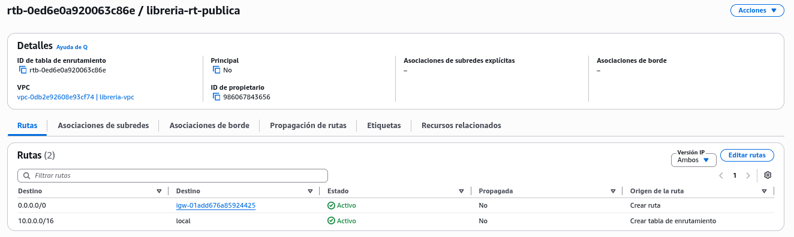

Por último, hemos asociado expresamente la subred `libreria-publica` a esta tabla, de modo que las instancias que se desplieguen en ella utilicen las rutas configuradas.

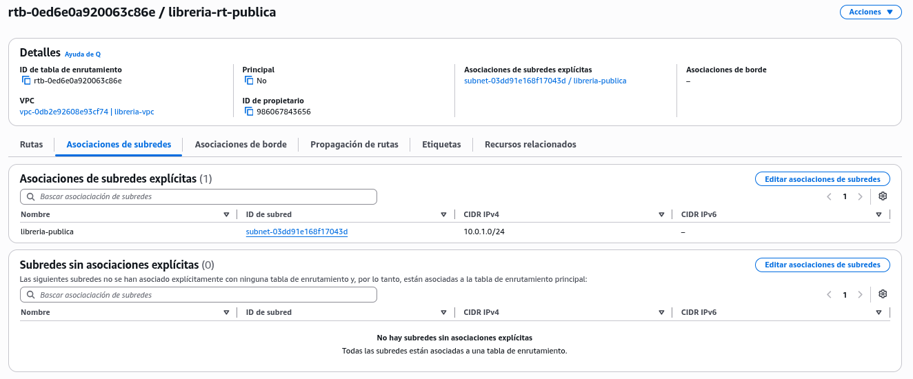

Con esta configuración, la infraestructura de red queda preparada para alojar los servidores EC2 de Librería Tinta.

## B2. Configuración de seguridad

### Grupo de seguridad

El acceso al servidor web se controla mediante el grupo de seguridad `libreria-web-sg`, asociado a nuestra VPC.

| Parámetro | Valor |
|---|---|
| Nombre | `libreria-web-sg` |
| ID | `sg-0a1b5c2a23679489e` |
| VPC | `libreria-vpc` |
| Descripción | Seguridad del servidor web Librería Tinta |
| Región | `us-east-1` |

### Reglas de entrada

| Tipo | Protocolo | Puerto | Origen |
|---|---|---|---|
| HTTP | TCP | 80 | `0.0.0.0/0` |
| SSH | TCP | 22 | `78.30.6.87/32` |

El puerto **80** está abierto a cualquier dirección para permitir el acceso público a la web.

En cambio, el puerto **22** se ha restringido a nuestra dirección IP pública. De esta manera, las conexiones SSH solo se admiten desde esa dirección, reduciendo la exposición del acceso administrativo.

### Reglas de salida

Hemos mantenido la configuración predeterminada de AWS, que permite todo el tráfico saliente. Esto facilita, entre otras operaciones, la descarga de paquetes y actualizaciones desde los repositorios de Amazon Linux.

### Comprobación de la configuración

La captura recoge las reglas de entrada del grupo `libreria-web-sg`, que posteriormente utilizaremos en la instancia EC2.

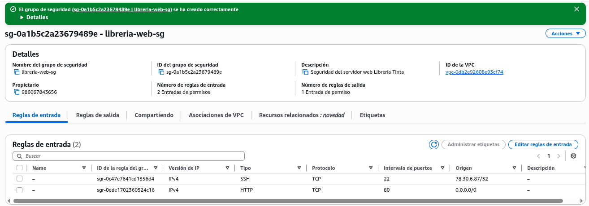

## B3. Despliegue del servidor web

### Creación de la instancia EC2

El servidor de Librería Tinta utiliza una instancia EC2 con Amazon Linux 2023, conectada a la VPC y al grupo de seguridad configurados anteriormente.

| Parámetro | Configuración |
|---|---|
| Nombre | `libreria-web` |
| AMI | Amazon Linux 2023 |
| Tipo de instancia | `t3.micro` |
| Par de claves | `vockey` |
| Región | `us-east-1` (Norte de Virginia) |
| VPC | `libreria-vpc` |
| Subred | `libreria-publica` |
| Dirección IPv4 pública automática | Habilitada |
| Grupo de seguridad | `libreria-web-sg` |
| Almacenamiento | Configuración predeterminada |

También hemos identificado la instancia mediante las etiquetas solicitadas:

| Clave | Valor |
|---|---|
| `Proyecto` | `P1` |
| `Alumno` | `José Antonio Alguacil` |

### Comprobación del despliegue

**Listado de instancias EC2**

La instancia `libreria-web` aparece en ejecución en la consola de Amazon EC2.

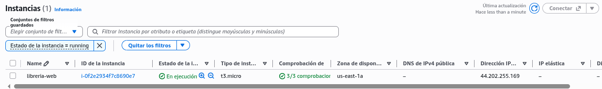

**Detalles de la instancia**

En la ficha de la instancia podemos consultar su dirección IP, configuración de red y grupo de seguridad asociado.

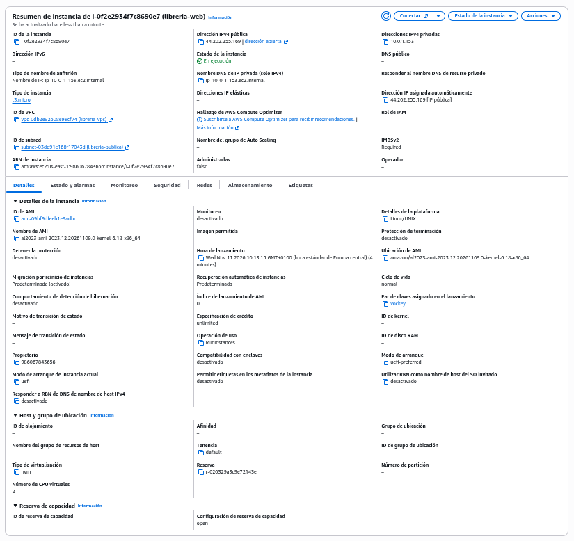

### Automatización del servidor web

Para preparar el servidor hemos utilizado un script de inicialización introducido en el apartado **Datos de usuario (User data)** durante el lanzamiento de EC2.

El script se encarga de:

1. Instalar nginx mediante `dnf`.
2. Habilitar e iniciar el servicio.
3. Crear el archivo `/usr/share/nginx/html/index.html`.
4. Incorporar el horario, la dirección ficticia, el libro recomendado y los datos del despliegue.

### Script de inicialización

El código utilizado se conserva en el repositorio como `scripts/user-data1.sh`.

```bash
#!/bin/bash
dnf install -y nginx
systemctl enable --now nginx

cat > /usr/share/nginx/html/index.html <<EOF
<!doctype html>
<html lang="es">
<head>
  <meta charset="utf-8">
  <title>Librería Tinta</title>
</head>
<body>
  <h1>Librería Tinta</h1>
  <p>Tu librería de barrio.</p>

  <h2>Horario</h2>
  <p>Lunes a viernes: 9:00 a 20:00</p>
  <p>Sábados: 10:00 a 14:00</p>

  <h2>Dirección</h2>
  <p>Calle de los Libros, 12, Sevilla (dirección ficticia)</p>

  <h2>Libro recomendado</h2>
  <p>Don Quijote de la Mancha, de Miguel de Cervantes.</p>

  <hr>
  <small>Desplegado por José Antonio Alguacil en el servidor $(hostname) el $(date '+%d/%m/%Y %H:%M')</small>
</body>
</html>
EOF
```

**Precaución:** `#!/bin/bash` debe ser la primera línea del archivo, sin espacios ni líneas en blanco anteriores. De lo contrario, la ejecución directa del script puede fallar.

### Incidencia durante la inicialización

En el primer intento, la página no cargaba desde la IP pública. Para investigar el problema accedimos al servidor por SSH y comprobamos el estado de nginx:

```bash
sudo systemctl status nginx --no-pager
```

El sistema devolvió:

```text
Unit nginx.service could not be found.
```

Esto indicaba que nginx no se había instalado. Revisamos entonces los registros de `cloud-init`, donde encontramos el error:

```text
Exec format error. Missing #! in script?
Reason: [Errno 8] Exec format error
```

El problema estaba en una línea en blanco situada antes de `#!/bin/bash`. Como consecuencia, `cloud-init` no podía ejecutar directamente el script.

Para corregirlo, eliminamos las líneas vacías iniciales del archivo recibido por la instancia y volvimos a ejecutarlo:

```bash
sudo sed -i '/./,$!d' /var/lib/cloud/instance/scripts/part-001
sudo /var/lib/cloud/instance/scripts/part-001
```

Esta vez la instalación terminó correctamente. nginx quedó habilitado para arrancar con el sistema y se generó la página HTML prevista.

También corregimos el archivo `scripts/user-data1.sh` del repositorio para evitar que el problema se repita en futuros despliegues.

### Verificación de la página web

Una vez iniciado nginx, accedimos desde Firefox a la dirección pública de la instancia:

**http://44.202.255.169**

La página de Librería Tinta cargó correctamente, mostrando el horario, la dirección ficticia, el libro recomendado y la información del servidor.

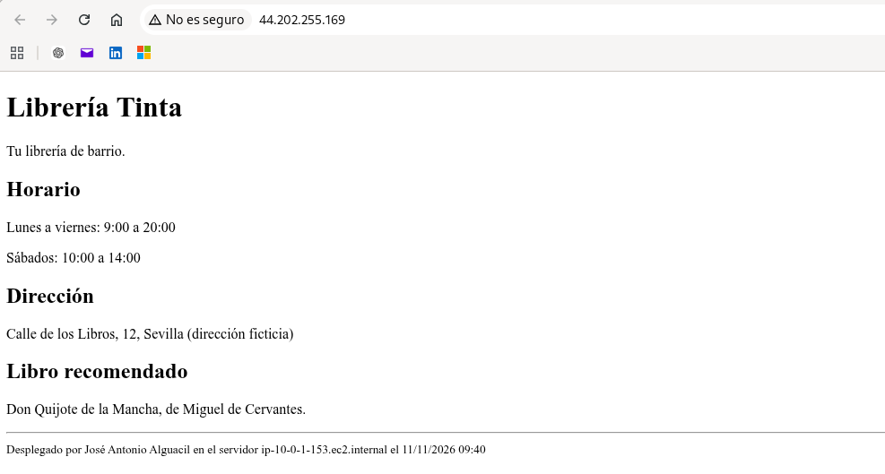

La prueba confirma que el servidor responde a las peticiones HTTP a través del puerto 80.

## B4. Estimación del coste mensual

Para conocer el coste de mantener la web disponible de forma continua, hemos preparado una estimación con **AWS Pricing Calculator**, tomando como referencia un mes completo de funcionamiento.

### Configuración de la estimación

| Parámetro | Valor |
|---|---|
| Servicio | Amazon EC2 |
| Región | `us-east-1` (Norte de Virginia) |
| Tipo de instancia | `t3.micro` |
| Sistema operativo | Linux |
| Número de instancias | 1 |
| Modalidad de pago | On-Demand |
| Utilización | 100 % (24 horas al día, 7 días a la semana) |
| Almacenamiento estimado | 8 GB SSD gp3 |
| Monitorización detallada | Desactivada |
| Transferencia de datos adicional | 0 GB |
| Instantáneas EBS | No incluidas |

La estimación contempla el funcionamiento permanente de una instancia, sin aplicar descuentos por reservas ni compromisos de uso.

El almacenamiento se ha calculado con 8 GB de SSD gp3, tomando como referencia la configuración predeterminada de Amazon Linux 2023.

### Resultado económico

| Concepto | Coste |
|---|---|
| Coste inicial | 0,00 USD |
| Coste mensual estimado | **8,23 USD** |
| Coste anual estimado | **98,76 USD** |

El presupuesto obtenido es de **8,23 USD mensuales**, equivalentes a **98,76 USD anuales**. Son importes estimados, sin impuestos ni posibles consumos adicionales no incluidos en el cálculo.

### Captura y enlace de la estimación

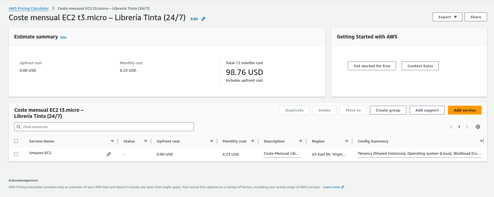

**[Consultar estimación en AWS Pricing Calculator](https://calculator.aws/#/estimate?id=93e771eaecb9809e3ddd9846ca2e80c06698b5dc)**

### Posibles medidas de ahorro

En nuestro caso, la medida más sencilla consiste en **detener la instancia EC2 cuando no estemos realizando prácticas**.

Mientras permanezca detenida, no se factura el tiempo de computación, aunque el volumen EBS sigue generando costes de almacenamiento.

Para servicios que necesiten funcionar permanentemente, también podrían estudiarse opciones como Savings Plans, que permiten reducir el precio a cambio de asumir un compromiso de uso.

Como se trata de un proyecto educativo, mantendremos la instancia activa únicamente cuando sea necesario trabajar con ella.


## M1. Segundo servidor web

### Despliegue de la segunda instancia EC2

Para comenzar el nivel medio del proyecto, hemos desplegado un segundo servidor web utilizando la infraestructura AWS ya configurada: la misma VPC, subred pública y grupo de seguridad.

La nueva instancia utiliza Amazon Linux 2023 y nginx, igual que el primer servidor, pero presenta una versión de la página que permite distinguir ambos servidores.

| Parámetro | Valor |
|---|---|
| Nombre | `libreria-web-2` |
| ID de instancia | `i-0359ab09c86cc7845` |
| Tipo | `t3.micro` |
| Sistema operativo | Amazon Linux 2023 |
| Región | `us-east-1` |
| Zona de disponibilidad | `us-east-1a` |
| VPC | `libreria-vpc` |
| Subred | `libreria-publica` |
| Grupo de seguridad | `libreria-web-sg` |
| Dirección IPv4 pública | `35.173.126.57` |
| Estado | En ejecución |
| Comprobaciones de estado | 3/3 superadas |

### Comprobación de las instancias

En la consola EC2 aparecen los dos servidores funcionando:

- `libreria-web`: `44.202.255.169`
- `libreria-web-2`: `35.173.126.57`

Ambos utilizan instancias `t3.micro` y se encuentran en la zona de disponibilidad `us-east-1a`.

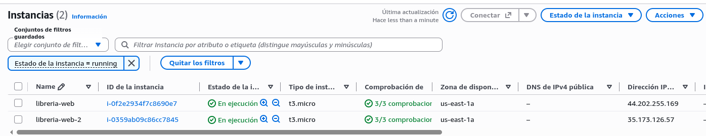

### Verificación del segundo servidor

Hemos accedido desde el navegador a la dirección:

**http://35.173.126.57**

La página muestra el título **«Librería Tinta - Versión 2»** y la identificación **«Servidor 2 - Segunda versión de la web»**, lo que permite diferenciarla de la página alojada en la primera instancia.

También aparecen correctamente el horario, la dirección ficticia, el libro recomendado y los datos del despliegue.

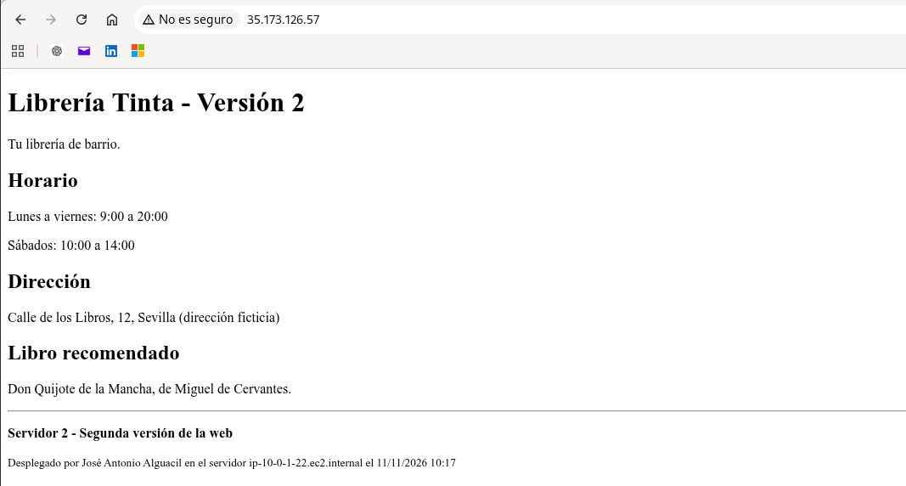

Con esta comprobación queda completado el despliegue del segundo servidor web. Ambos servidores responden de forma independiente a través de sus respectivas direcciones IPv4 públicas.


### Comprobación del reparto DNS ponderado

Una vez creados los dos registros A de `web.libreria.lab`, hemos comprobado su resolución desde la primera instancia EC2, situada dentro de la VPC.

La consulta inicial se realizó mediante:

```bash
dig web.libreria.lab
```

El resultado fue satisfactorio (`NOERROR`). El servidor DNS interno de AWS (`10.0.0.2`) devolvió la dirección privada `10.0.1.153`, correspondiente al primer servidor.

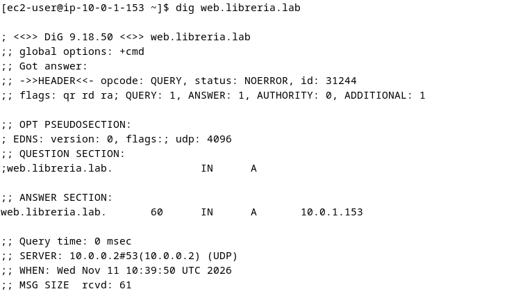

#### Primera prueba: 30 consultas consecutivas

Para observar la distribución de las respuestas DNS, ejecutamos:

```bash
for i in $(seq 1 30); do dig +short web.libreria.lab; done | sort | uniq -c
```

Resultado:

```text
30 10.0.1.153
```

Las 30 consultas devolvieron la dirección del primer servidor. Este comportamiento puede estar relacionado con la caché DNS, ya que los registros tienen un TTL de 60 segundos.

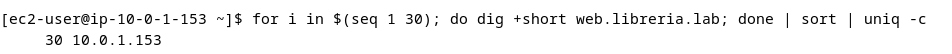

#### Segunda prueba: consultas espaciadas

Para reducir la influencia de la caché, repetimos la prueba introduciendo una espera de 65 segundos entre consultas, superior al TTL configurado.

```bash
for i in $(seq 1 10); do
  dig +short web.libreria.lab
  sleep 65
done | sort | uniq -c
```

El comando realiza diez consultas y agrupa los resultados por dirección IP.


**Resultado de la prueba:**

| Servidor | IP privada | Peso DNS | Respuestas | Porcentaje |
|---|---|---:|---:|---:|
| Servidor 1 | `10.0.1.153` | 80 | 9 | 90 % |
| Servidor 2 | `10.0.1.22` | 20 | 1 | 10 % |
| **Total** | | **100** | **10** | **100 %** |

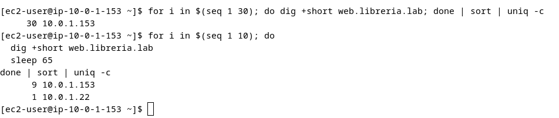

Las consultas espaciadas devolvieron direcciones de ambos servidores. El reparto observado fue del 90 % para el primero y del 10 % para el segundo.

Aunque estos porcentajes no coinciden exactamente con los pesos 80/20, el resultado es compatible con el funcionamiento probabilístico del enrutamiento ponderado de Route 53. Diez consultas no son suficientes para esperar una distribución exacta.


### Comprobación de las respuestas HTTP

Después de verificar el funcionamiento de Route 53, hemos realizado peticiones HTTP al nombre `web.libreria.lab` desde una instancia EC2 de la misma VPC.

El objetivo es comprobar que las dos versiones de Librería Tinta son accesibles a través del nombre DNS privado.

Para ello, utilizamos el siguiente comando:

```bash
for i in $(seq 1 5); do
  curl -s --max-time 5 http://web.libreria.lab/ | grep -m 1 '<h1>'
  sleep 65
done | sort | uniq -c
```

Se realizan cinco peticiones separadas por 65 segundos, superando el TTL de 60 segundos configurado en Route 53 para reducir la influencia de la caché DNS.

El comando extrae el título principal (`<h1>`) de cada página y agrupa las respuestas iguales.


**Resultado de la prueba:**

| Servidor | Respuestas HTTP | Porcentaje |
|---|---:|---:|
| Servidor 1 — Librería Tinta | 4 | 80 % |
| Servidor 2 — Librería Tinta - Versión 2 | 1 | 20 % |
| **Total** | **5** | **100 %** |

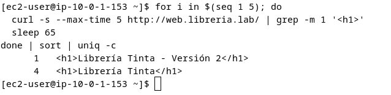

Las cinco peticiones realizadas mediante `curl` obtuvieron cuatro respuestas del primer servidor y una del segundo.

En esta ejecución, la distribución coincidió con los pesos 80/20 configurados en Route 53. La prueba confirma que ambos servidores responden correctamente a través de `web.libreria.lab` y que el enrutamiento ponderado está operativo.

La coincidencia exacta de porcentajes es circunstancial: Route 53 aplica una distribución probabilística y los resultados pueden variar entre pruebas.


## M2. Actualización del coste del proyecto

Tras incorporar el segundo servidor web y configurar Route 53, hemos actualizado la estimación económica mediante AWS Pricing Calculator.

El cálculo contempla dos instancias EC2 `t3.micro` con Linux, funcionando las 24 horas del día en la región `us-east-1`, y una zona DNS privada de Route 53 (`libreria.lab`).

### Resultado de la estimación

| Servicio | Coste mensual |
|---|---:|
| Amazon EC2 — 2 instancias `t3.micro` | 16,46 USD |
| Amazon Route 53 — 1 zona alojada privada | 0,50 USD |
| **Total mensual** | **16,96 USD** |
| **Total anual** | **203,52 USD** |

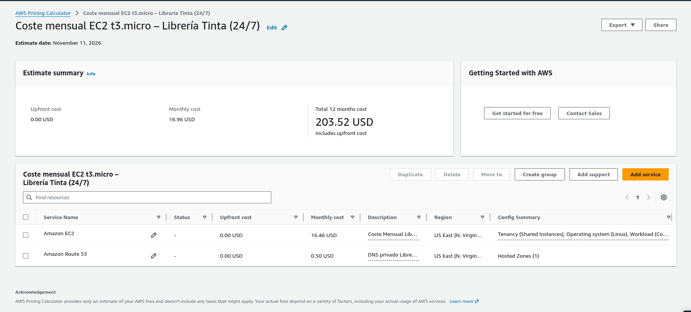

El presupuesto inicial, correspondiente a un único servidor, era de 8,23 USD mensuales. Con el segundo servidor y la zona DNS privada, aumenta a 16,96 USD al mes.

La estimación no incluye impuestos ni posibles consumos adicionales. Para Route 53 se ha considerado el mantenimiento de la zona privada, sin cargos por consultas DNS realizadas desde la VPC.

**[Consultar presupuesto actualizado en AWS Pricing Calculator](https://calculator.aws/#/estimate?id=e83bd18587acb355cbf8fd1a1f58472261e46dba)**


